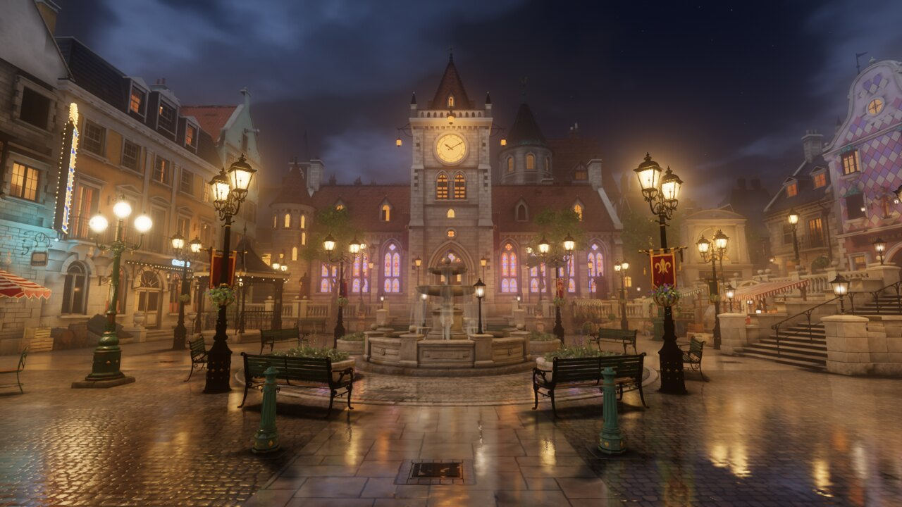
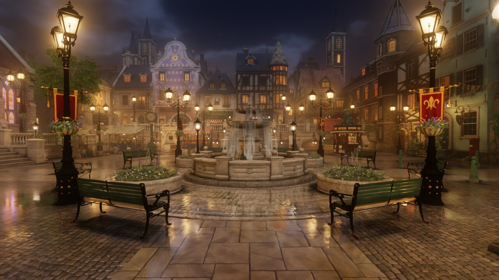

# LanternTown

A lantern-lit town square at night that you walk around in, in the browser, at 60 fps on a phone.
Every model, material and texture in it is generated by code: 130+ parametric assets written as
Python generators and built with the Blender command line, composed by a rule-based layout into a
town, lit and baked offline, and drawn with three.js (`WebGPURenderer`, WebGL 2 fallback).




**Live:** https://zalo.github.io/LanternTown/ - the [walk](https://zalo.github.io/LanternTown/town/) and the
[gallery](https://zalo.github.io/LanternTown/gallery/). More routes under [Try it](#try-it).

The project was built by coding agents under one person's direction. `prompt.md` is the brief with
everything learnt on the way folded in: give it to an agent to reproduce the project, or read it
as the long-form design document.

## Try it

Everything below runs from the GitHub Pages site. The walk needs WebGPU or WebGL 2; the quality menu on the
page toggles the lens flare, the ground shadows and the preset without a reload.

**Walk the town**

- [High](https://zalo.github.io/LanternTown/town/) (the default) ·
  [Medium](https://zalo.github.io/LanternTown/town/?quality=medium) ·
  [Low](https://zalo.github.io/LanternTown/town/?quality=low) ·
  [Phone](https://zalo.github.io/LanternTown/town/?quality=phone)

**The town as one GLB** - the stock three.js `GLTFLoader`, nothing of ours in the loader

- [Walk the finest file](https://zalo.github.io/LanternTown/glbtown/) (53 MB)
- The coarser levels alone, what the level-of-detail system switches between:
  [near](https://zalo.github.io/LanternTown/glbtown/?file=town_near.glb) ·
  [middle](https://zalo.github.io/LanternTown/glbtown/?file=town_mid.glb) ·
  [lowest](https://zalo.github.io/LanternTown/glbtown/?file=town_lo.glb) ·
  [near, sky as a plain background](https://zalo.github.io/LanternTown/glbtown/?file=town_near.glb&sky=background)
- [Orbit viewer](https://zalo.github.io/LanternTown/bakeglb/view.html?file=town_best.glb)
- [Capsule collision with three-mesh-bvh](https://zalo.github.io/LanternTown/glbtown/?file=town_best.glb&walk=bvh&collide=town_lo.glb)
  against the lowest level (a prototype; add `&bvhshow=1` to see the collision mesh)

**`MSFT_lod` and the lazy `GLTFLoader`** - the patches in `docs/gltfloader/`

- [Tier B, levels loaded lazily by range requests](https://zalo.github.io/LanternTown/gltflod/?tier=b) ·
  [Tier A, no API change](https://zalo.github.io/LanternTown/gltflod/?tier=a) ·
  [Tier B with each level tinted](https://zalo.github.io/LanternTown/gltflod/?tier=b&tint=1)
- [The lazy loader on the one-file town with levels](https://zalo.github.io/LanternTown/bakeglb/view.html?file=town_lod.glb&loader=b) (88 MB, read in parts)
- [The test kit's check page](https://zalo.github.io/LanternTown/out/web/_nextglb/msft_lod_kit/check.html) ·
  [the patches](https://zalo.github.io/LanternTown/docs/gltfloader/README.md)

**Textures compressed on the device** - WebP on the wire, GPU formats in memory, encoded at load time

- [High, with a readout](https://zalo.github.io/LanternTown/town/?quality=high&ktxinfo=1) ·
  [High, off](https://zalo.github.io/LanternTown/town/?quality=high&tc=0&ktxinfo=1) ·
  [Phone, ASTC forced](https://zalo.github.io/LanternTown/town/?quality=phone&tcforce=astc&ktxinfo=1)

**Downloads** - portable GLBs (unlit, baked light in the vertex colours, Draco, WebP) that open in Blender and three.js

- One-file towns: [finest, 53 MB](https://zalo.github.io/LanternTown/out/web/_nextglb/town_best.glb) ·
  [near, 32 MB](https://zalo.github.io/LanternTown/out/web/_nextglb/town_near.glb) ·
  [middle, 12 MB](https://zalo.github.io/LanternTown/out/web/_nextglb/town_mid.glb) ·
  [lowest, 6 MB](https://zalo.github.io/LanternTown/out/web/_nextglb/town_lo.glb) ·
  [with `MSFT_lod` levels, 88 MB](https://zalo.github.io/LanternTown/out/web/_nextglb/town_lod.glb)
- Level-of-detail demo files: [thirteen chunks around the spawn, 30 MB](https://zalo.github.io/LanternTown/out/web/_nextglb/portable_lod_spawn.glb) ·
  [the same in the bake's own vertex format, 67 MB](https://zalo.github.io/LanternTown/out/web/_nextglb/exact_lod_spawn.glb)
- [The source and `prompt.md` as one zip](https://zalo.github.io/LanternTown/api/source.zip) ·
  [the pipeline as a Claude Code skill, `parametric-environment`](https://zalo.github.io/LanternTown/api/skill.zip) ·
  [all of the above as cards](https://zalo.github.io/LanternTown/gallery/#demos)

Not on the static site, because they read the full-detail models or need the local server: the Studio presets,
the 3D asset viewer, the second town, the KTX2 and light-probe experiments and the benchmark (`python3
tools/serve.py` serves them all).

## What is in here

| Path | What |
|---|---|
| `assets/<class>/<id>.py` | one generator per asset: docstring, `META`, `PARAMS`, `VARIANTS`, `build(p, rng)`. Seeds and parameters give variants; nothing is hand-placed. |
| `release/` | the copies of the generators the town is built from (`tools/town.py release` updates them) |
| `materials/` | procedural PBR materials (albedo, normal, ORM), one file each |
| `tk/` | the modelling toolkit the generators use (geometry builders, UVs, weathering, sockets, levels of detail) |
| `town/`, `town2/` | layout generators for the town and a second, smaller assembly |
| `tools/` | the pipeline: `tsq` (assets and materials), `town.py` (layout, builds), `webbake.py` (the bake), `bake2glb.mjs` (portable GLB exports), `serve.py` (local server), `site.py` (static site), checks and measurements |
| `web/` | the pages: `gallery/`, `town/` (the walk), `engine/` (the runtimes), `glbtown/`, `gltflod/`, `bakeglb/` (demos) |
| `docs/` | authoring and quality guides, the toolkit API, the asset catalogue, the GLTFLoader work |
| `prompt.md` | the replication brief |

Generated data is not in the repository: built models, baked materials, renders and the baked town
all go to `out/` (tens of GB on the authoring machine), and the judges' scores and notes to
`reviews/`. The one exception is `out/web/_nextglb/msft_lod_kit/`, the sources of the `MSFT_lod`
test kit, which live beside the models they generate.

## Requirements

- Python 3.10+ (the host scripts use the standard library only)
- [Blender](https://www.blender.org/) 4.1 on the `PATH`, or named by `TSQ_BLENDER`
- Node.js 22+ and `npm install` (three.js, meshoptimizer, draco3dgltf)
- Chromium or Chrome with WebGPU for the review renders and the visibility pass of the bake
  (`tools/gpu_chrome.sh` starts a headless one; `CHROME_BIN` overrides the binary)
- ImageMagick (`magick`) and fontconfig (`fc-match`; sign lettering uses installed fonts)
- A GPU helps: Cycles bakes the lighting, and the renders go through the browser

## Building it

The commands below are the ones the project was built with. A complete run from a clean checkout
has not been tested; expect a few hours of Blender time for the models and about an hour per bake
on a 32-core machine with a fast GPU.

```bash
npm install

# materials -> out/mat/
tools/tsq mats                         # status table; `tools/tsq mat <name>[,<name>...]` bakes

# one asset, to look at -> out/glb/<id>/, review renders -> out/renders/<id>/
tools/tsq build lamp_post_gas
tools/tsq render lamp_post_gas

# the town: layout, every model it uses (with levels of detail), terrain, placement -> out/town/town.json
TSQ_ASSET_DIR=release python3 tools/town.py all

# the baked town the walk page loads -> out/web/_next/
python3 tools/webbake.py --out out/web/_next --pvs

# look at it
python3 tools/serve.py                 # http://localhost:8765/gallery/  and  /town/
```

`docs/AUTHORING.md` is the guide for writing an asset, `docs/QUALITY.md` and
`docs/TOWN_QUALITY.md` are what the judges score against, `docs/LOD.md` covers levels of detail,
and section 8 of `prompt.md` describes the bake and the runtime in full.

## The walk page

`/town/` opens on the High preset; the menu on the page switches between Phone, Low, Medium and
High and remembers the choice. `?quality=studio` is a second runtime that streams the unbaked
models with every lantern as a real light (desktop graphics cards only).

How it gets to 60 fps on a phone, in short: all lighting is baked into vertex colours (with a
least-squares refit so simplified meshes keep their light), the town is cut into cells with four
levels of detail each and merged into a few draw calls per cell, materials share texture arrays,
cells are culled by frustum and by a precomputed visibility set, and the frame is drawn at pixel
ratio 1 with temporal anti-aliasing. Ambient occlusion and ground shadows are baked into two small
textures; bloom, fog scattering and the optional lens flare read one shared blur pyramid.

### What the page reports

`web/engine/telemetry.js` posts the page's log lines, frame-rate figures and the device type to
`/api/telemetry` on the server the page came from, where `tools/serve.py` writes them to
`out/.telemetry/`. Nothing goes to a third party, and a page opened from `localhost` reports nothing
unless asked to (`?telemetry=1`). On a host without that endpoint the reports are dropped;
`?telemetry=0` turns them off for a visit, and removing the `telemetry.js` script tag from the
pages' `index.html` removes them altogether.

## Publishing it as a static site

`python3 tools/site.py` assembles `out/site/`: the pages, three.js, the baked town, the gallery's
pictures, the one-file `.glb` towns and a frozen copy of the gallery's data, laid out the way the
local server serves them, so any static host can carry it (`--dry` prints the size report only,
`--no-glb` leaves the `.glb` downloads out, `--town2` adds the second town). The pages use relative
URLs throughout, so the site works from a sub-path such as `https://<user>.github.io/<repo>/`.

What a static host cannot carry: the Studio preset and the 3D asset viewer (they read the
full-detail models in `out/glb/`, well over a gigabyte), and the telemetry endpoint. The gallery
hides its links to those when it is served from a site made this way.

The lazy level-of-detail loader depends on HTTP range requests, which GitHub Pages answers. The
result is about 850 MB with no file over 100 MB: inside Pages' limits (1 GB a site, 100 MB a file),
with little room to grow.

### GitHub Pages without the data in the repository

The repository stays small (source only); the site's generated part travels as the assets of one
release beside it, in parts named by their content, so that only what changed is uploaded:

```bash
python3 tools/site.py --upload data     # on the machine that has out/: writes out/site-data/ (~830 MB in
                                        # ~40 parts) and brings the release `data` up to date through gh
```

`.github/workflows/pages.yml` (on every push to `main`, or by hand from the Actions tab) checks the
repository out, installs three.js, downloads the parts from the release named by its `DATA_TAG`, runs
`python3 tools/site.py --out _site --data site-data` and deploys the folder. Pages has to be set to
"GitHub Actions" as its source once (Settings > Pages). So the pages and the engine on the site are
always the repository's, and the baked town they load is the release the workflow names: after a new
bake, `--upload` again (the bake's parts go up, the pictures and `.glb` files stay) and run the
workflow again.

Deploying from a branch instead also works (`out/site/` pushed to a `gh-pages` branch; the folder
holds the `.nojekyll` file that needs), at the price of every bake staying in that branch's history.

## glTF `MSFT_lod` for three.js

`docs/gltfloader/` holds two patches to three.js's `GLTFLoader`: one that turns `MSFT_lod` level
chains into `THREE.LOD` objects with no API change, and one that also loads levels lazily (by HTTP
range requests out of a single `.glb`). `web/gltflod/` is the demo, and `tools/bake2glb.mjs`
writes the town as portable GLBs (unlit, vertex-colour light, Draco, WebP, `MSFT_lod`) that open
in Blender and in three.js.

## Reusing the pipeline for another environment

`skill/` packages everything here as a Claude Code skill, `parametric-environment`: the process in phases, the
rubrics and brief templates, the measured lessons (what made assets pass, what the bake and the look needed, what
cost time), and a ready-to-copy project with the toolkit, tools, runtime, materials and asset generators.
`python3 skill/install.py` installs it to `~/.claude/skills/parametric-environment/`; the same thing zipped is
[api/skill.zip](https://zalo.github.io/LanternTown/api/skill.zip) on the site (`python3 tools/srczip.py --skill -o skill.zip`
makes it locally) - unzip it into `~/.claude/skills/`. It is written for any
walkable environment, not only a town at night; the lantern town is its worked example.

## Credits

The mood takes after the lamplit storybook town squares of late-90s and 2000s adventure games;
this is an independent work, and it contains no assets from any game. Third-party code and methods
are listed in `THIRD_PARTY_NOTICES.md`.

## Licence

MIT - see `LICENSE`.
